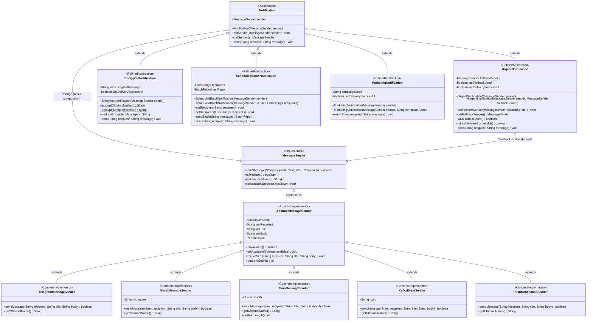

# Assignment 3 — Multi-Channel Notification Gateway (Bridge Pattern)

> **Course**: Software Design Patterns  
> **Topic**: GoF Bridge Pattern (Decoupling Abstraction from Implementation)  
> **Language**: Java 17+ LTS  
> **Build Tool**: Apache Maven  
> **Testing Framework**: JUnit 5 (Jupiter)  

---

## 1. Executive Summary & Problem Domain

The **Multi-Channel Notification Gateway** addresses the problem of delivering diverse types of notifications across multiple communication transport channels.

### The Problem Without Bridge (Cartesian Class Explosion)
In a naive inheritance-based architecture, every combination of notification behavior and transport channel requires a dedicated subclass:
```
UrgentTelegramNotification
UrgentEmailNotification
UrgentSmsNotification
UrgentKafkaNotification
EncryptedTelegramNotification
EncryptedEmailNotification
EncryptedSmsNotification
EncryptedKafkaNotification
ScheduledBatchTelegramNotification
...
```
For $N$ notification types and $M$ message transport providers, an inheritance hierarchy results in **$N \times M$ classes**.
- Adding 1 new provider requires creating $N$ new classes.
- Adding 1 new notification type requires creating $M$ new classes.
- Transport mechanisms cannot be switched dynamically at runtime without replacing the entire object instance.

### The Solution With Bridge Pattern
The **GoF Bridge Pattern** solves this problem by separating the system into two orthogonal, independently evolving hierarchies:
1. **Abstraction Hierarchy**: What kind of notification is being sent (business domain rules: urgency tagging, encryption, batch aggregation, marketing branding).
2. **Implementor Hierarchy**: How and where the message is transported (protocol-specific mechanics: Telegram Bot API HTML formatting, SMTP email with headers/signatures, SMS character trimming, Kafka event streaming, APNs/FCM push payloads).

Instead of $N \times M$ classes, the system scales linearly as **$N + M$ classes**, and transport implementations can be switched dynamically at runtime via composition.

---

## 2. Architecture & Pattern Role Mapping

| Pattern Role | Class / Interface | Responsibility |
| :--- | :--- | :--- |
| **Abstraction** | [`Notification`](src/main/java/com/notification/abstraction/Notification.java) | Maintains a reference (`protected MessageSender sender`) to the Implementor; defines the high-level `send(recipient, message)` business contract. |
| **Refined Abstraction** | [`UrgentNotification`](src/main/java/com/notification/abstraction/UrgentNotification.java) | Adds `[URGENT]` tag, verifies provider availability, and automatically routes to a secondary fallback sender without using `instanceof`. |
| **Refined Abstraction** | [`EncryptedNotification`](src/main/java/com/notification/abstraction/EncryptedNotification.java) | Encrypts message payload (Base64 encoding/decoding) before delegating to the bridged sender. |
| **Refined Abstraction** | [`ScheduledBatchNotification`](src/main/java/com/notification/abstraction/ScheduledBatchNotification.java) | Manages collections of recipients, broadcasts messages, and outputs structured execution metrics (`Total`, `Successful`, `Failed`). |
| **Refined Abstraction (Extension)** | [`MarketingNotification`](src/main/java/com/notification/abstraction/MarketingNotification.java) | Attaches marketing campaign identifiers, call-to-action headers, and opt-out unsubscribe footers. |
| **Implementor** | [`MessageSender`](src/main/java/com/notification/implementor/MessageSender.java) | Common interface defining primitives: `sendMessage(recipient, title, body)`, `isAvailable()`, `getChannelName()`, `setAvailable(boolean)`. |
| **Implementor Base** | [`AbstractMessageSender`](src/main/java/com/notification/implementor/AbstractMessageSender.java) | Encapsulates state tracking, telemetry history, and availability toggles. |
| **Concrete Implementor** | [`TelegramMessageSender`](src/main/java/com/notification/implementor/TelegramMessageSender.java) | Formats messages using HTML tags (`<b>title</b>\nbody`) simulating Telegram Bot API delivery. |
| **Concrete Implementor** | [`EmailMessageSender`](src/main/java/com/notification/implementor/EmailMessageSender.java) | Formats email payloads with structured subject lines and formal corporate signatures. |
| **Concrete Implementor** | [`SmsMessageSender`](src/main/java/com/notification/implementor/SmsMessageSender.java) | Enforces and trims messages to maximum character constraints (standard: 160 characters, configurable). |
| **Concrete Implementor** | [`KafkaEventSender`](src/main/java/com/notification/implementor/KafkaEventSender.java) | Publishes JSON-serialized event records to an Apache Kafka messaging topic. |
| **Concrete Implementor (Extension)** | [`PushNotificationSender`](src/main/java/com/notification/implementor/PushNotificationSender.java) | Formats and dispatches APNs/FCM mobile push notification payloads with badge and sound metadata. |

---

## 3. UML Class Diagram

### Mermaid Diagram


### PlantUML Source

```plantuml
@startuml
skinparam classAttributeIconSize 0
skinparam monochrome false
skinparam roundcorner 8

package "Abstraction Hierarchy" {
    abstract class Notification <<Abstraction>> {
        # sender : MessageSender
        + Notification(sender: MessageSender)
        + setSender(sender: MessageSender) : void
        + getSender() : MessageSender
        + {abstract} send(recipient: String, message: String) : void
    }

    class UrgentNotification <<RefinedAbstraction>> {
        - fallbackSender : MessageSender
        - lastFallbackUsed : boolean
        - lastDeliverySuccessful : boolean
        + UrgentNotification(sender: MessageSender)
        + UrgentNotification(sender: MessageSender, fallbackSender: MessageSender)
        + setFallbackSender(fallbackSender: MessageSender) : void
        + wasFallbackUsed() : boolean
        + send(recipient: String, message: String) : void
    }

    class EncryptedNotification <<RefinedAbstraction>> {
        - lastEncryptedMessage : String
        + EncryptedNotification(sender: MessageSender)
        + {static} encrypt(plainText: String) : String
        + {static} decrypt(cipherText: String) : String
        + send(recipient: String, message: String) : void
    }

    class ScheduledBatchNotification <<RefinedAbstraction>> {
        - recipients : List<String>
        - lastReport : BatchReport
        + ScheduledBatchNotification(sender: MessageSender)
        + addRecipient(recipient: String) : void
        + sendBatch(message: String) : BatchReport
        + send(recipient: String, message: String) : void
    }

    class MarketingNotification <<RefinedAbstraction>> {
        - campaignCode : String
        + MarketingNotification(sender: MessageSender)
        + MarketingNotification(sender: MessageSender, campaignCode: String)
        + send(recipient: String, message: String) : void
    }
}

package "Implementor Hierarchy" {
    interface MessageSender <<Implementor>> {
        + {abstract} sendMessage(recipient: String, title: String, body: String) : boolean
        + {abstract} isAvailable() : boolean
        + {abstract} getChannelName() : String
        + {abstract} setAvailable(available: boolean) : void
    }

    abstract class AbstractMessageSender {
        - available : boolean
        - sentCount : int
        + isAvailable() : boolean
        + setAvailable(available: boolean) : void
        # recordSent(recipient: String, title: String, body: String) : void
    }

    class TelegramMessageSender <<ConcreteImplementor>> {
        + sendMessage(recipient: String, title: String, body: String) : boolean
        + getChannelName() : String
    }

    class EmailMessageSender <<ConcreteImplementor>> {
        - signature : String
        + sendMessage(recipient: String, title: String, body: String) : boolean
        + getChannelName() : String
    }

    class SmsMessageSender <<ConcreteImplementor>> {
        - maxLength : int
        + sendMessage(recipient: String, title: String, body: String) : boolean
        + getChannelName() : String
    }

    class KafkaEventSender <<ConcreteImplementor>> {
        - topic : String
        + sendMessage(recipient: String, title: String, body: String) : boolean
        + getChannelName() : String
    }

    class PushNotificationSender <<ConcreteImplementor>> {
        + sendMessage(recipient: String, title: String, body: String) : boolean
        + getChannelName() : String
    }
}

Notification <|-- UrgentNotification
Notification <|-- EncryptedNotification
Notification <|-- ScheduledBatchNotification
Notification <|-- MarketingNotification

MessageSender <|.. AbstractMessageSender
AbstractMessageSender <|-- TelegramMessageSender
AbstractMessageSender <|-- EmailMessageSender
AbstractMessageSender <|-- SmsMessageSender
AbstractMessageSender <|-- KafkaEventSender
AbstractMessageSender <|-- PushNotificationSender

Notification o--> MessageSender : " Bridge (composition)"
UrgentNotification o--> MessageSender : " Fallback sender"
@enduml
```


---

## 4. Defense Questions & In-Depth Technical Answers

### Q1: What are the two independent dimensions?
The two independent dimensions in this system are:
1. **The Abstraction Dimension (Notification Types)**: Represents the **domain semantics and business logic** of what is being communicated (e.g. urgent prioritization, encryption confidentiality, batch aggregation metrics, promotional campaign branding).
2. **The Implementation Dimension (Delivery Channels / Providers)**: Represents the **transport and protocol infrastructure** of how and where messages are dispatched (e.g. Telegram Bot HTML format, SMTP headers and signatures, SMS 160-character cellular limit, Kafka distributed event streaming, APNs/FCM mobile push notifications).

### Q2: Where exactly is the Bridge?
The Bridge is the **composition reference** `protected MessageSender sender;` declared in the base abstraction class [`Notification`](src/main/java/com/notification/abstraction/Notification.java#L19). 
Rather than hardcoding transport logic in notification subclasses, `Notification` delegates delivery through this interface reference (`sender.sendMessage(...)`). The bridge physically bridges the abstract business contract to polymorphic message sender implementations.

### Q3: Why is inheritance problematic here?
Inheritance statically binds the abstraction to its implementation at compile time. 
- **Combinatorial Explosion**: Combining $N$ notification types with $M$ transport providers produces $N \times M$ subclasses. With 4 types and 5 providers, that requires 20 classes.
- **Fragility & High Maintenance**: Adding a single new provider forces writing $N$ new classes; adding a new notification type requires writing $M$ new classes.
- **Inability to Switch at Runtime**: A subclass instance like `UrgentTelegramNotification` cannot dynamically change its delivery channel to SMS during an outage without destroying and re-instantiating the object.
- **Code Duplication**: Formatting logic (e.g., Base64 encryption or SMS 160-char trimming) would be copy-pasted across dozens of combination classes.

### Q4: What happens when a new provider is added?
When a new provider is added (such as `PushNotificationSender` or `WhatsAppMessageSender`):
1. We create **exactly 1 new class** implementing `MessageSender`.
2. **Zero lines of code** in the Abstraction hierarchy (`Notification`, `UrgentNotification`, `EncryptedNotification`, `ScheduledBatchNotification`, `MarketingNotification`) are touched or modified.
3. The new provider is immediately and automatically compatible with all existing and future notification types. This adheres directly to the **Open/Closed Principle (OCP)**.

### Q5: What happens when a new Notification type is added?
When a new notification type is added (such as `MarketingNotification` or `SilentNotification`):
1. We create **exactly 1 new class** extending `Notification`.
2. **Zero lines of code** in the Implementor hierarchy (`TelegramMessageSender`, `EmailMessageSender`, `SmsMessageSender`, `KafkaEventSender`, `PushNotificationSender`) are touched or modified.
3. The new notification type immediately works with all existing and future message senders without any extra glue code.

### Q6: Why is this Bridge rather than Adapter?
| Characteristic | Bridge Pattern | Adapter Pattern |
| :--- | :--- | :--- |
| **Design Intent** | Designed **upfront** before components exist to let two independent dimensions vary orthogonally. | Designed **retrospectively (after the fact)** to make two incompatible, existing interfaces collaborate. |
| **Structure** | **Two parallel class hierarchies** connected via a composition reference (`Notification` has-a `MessageSender`). | A **single wrapper class** adapting a single adaptee to an existing target interface. |
| **Coupling** | Abstraction provides high-level business workflow and delegates low-level primitives to the implementor interface designed specifically for it. | Adapter converts foreign, legacy, or third-party method signatures into a local target interface without changing either end. |
| **Primary Goal** | Avoid $N \times M$ class explosion and decouple abstraction from implementation. | Interface conversion and retrofitted compatibility. |

---

## 5. Independent Extension Demonstration

To demonstrate the power of the Bridge pattern, two extensions were created after the initial design:
1. **New Concrete Implementor**: `PushNotificationSender`
   - Added without touching `Notification`, `UrgentNotification`, `EncryptedNotification`, or `ScheduledBatchNotification`.
2. **New Refined Abstraction**: `MarketingNotification`
   - Added without touching `TelegramMessageSender`, `EmailMessageSender`, `SmsMessageSender`, or `KafkaEventSender`.

Because the Bridge pattern decouples both hierarchies:
- `MarketingNotification` works out of the box with the original `EmailMessageSender`.
- The new `PushNotificationSender` works out of the box with the original `UrgentNotification`.
- Both independent extensions can be combined (`MarketingNotification` + `PushNotificationSender`) seamlessly without writing any intermediate adapter classes!

---

## 6. Mandatory Demonstration Scenarios (`Main.java`)

Executing `com.notification.Main` demonstrates all 6 required scenarios:

```
=====================================================================================
  ASSIGNMENT 3: MULTI-CHANNEL NOTIFICATION GATEWAY (BRIDGE PATTERN)
=====================================================================================

-------------------------------------------------------------------------------------
[SCENARIO 1] UrgentNotification + TelegramMessageSender
-------------------------------------------------------------------------------------
[Telegram Sender] [200 OK] -> Chat: @devops_lead | Formatted Message:
<b>[URGENT] High-Priority Alert</b>
[URGENT] Database connection pool saturated (98% usage)!

-------------------------------------------------------------------------------------
[SCENARIO 2] EncryptedNotification + EmailMessageSender
-------------------------------------------------------------------------------------
[Email Sender] [SMTP Sent] -> To: <security-officer@university.edu>
Subject: Encrypted Transmission
Body:
Q29uZmlkZW50aWFsIHN0dWRlbnQgQVBJIHRva2VuOiBzZWNfand0Xzk4MTcyNjQ4MTc=

--
Best regards,
Multi-Channel Notification Gateway System

-------------------------------------------------------------------------------------
[SCENARIO 3] ScheduledBatchNotification + SmsMessageSender (Summary Output)
-------------------------------------------------------------------------------------
[SMS Gateway] [GSM Sent] -> MSISDN: +1-555-0101 | Chars: [79/160]
Content: Exam schedule updated for Software Design Patterns. Please check Moodle portal.
[SMS Gateway] [GSM Sent] -> MSISDN: +1-555-0102 | Chars: [79/160]
Content: Exam schedule updated for Software Design Patterns. Please check Moodle portal.
[SMS Gateway] [GSM Sent] -> MSISDN: +1-555-0103 | Chars: [79/160]
Content: Exam schedule updated for Software Design Patterns. Please check Moodle portal.
Total: 3
Successful: 3
Failed: 0

-------------------------------------------------------------------------------------
[SCENARIO 4] Runtime Provider Switching (Telegram -> Email)
-------------------------------------------------------------------------------------
>>> Sending with initial provider: Telegram
[Telegram Sender] [200 OK] -> Chat: @sysadmin | Formatted Message:
<b>[URGENT] High-Priority Alert</b>
[URGENT] Scheduled server maintenance begins in 15 minutes.

>>> Dynamically switching sender at runtime to: Email (without altering notification instance)
[Email Sender] [SMTP Sent] -> To: <sysadmin>
Subject: [URGENT] High-Priority Alert
Body:
[URGENT] Scheduled server maintenance begins in 15 minutes.

--
Best regards,
Multi-Channel Notification Gateway System

-------------------------------------------------------------------------------------
[SCENARIO 5] Fallback Mechanism: Telegram Unavailable -> Fallback to SMS
-------------------------------------------------------------------------------------
>>> Primary Sender (Telegram) available: false
>>> Fallback Sender (SMS) available: true
[UrgentNotification] Primary sender [Telegram] is unavailable. Routing to fallback [SMS].
[SMS Gateway] [GSM Sent] -> MSISDN: +1-555-9999 | Chars: [60/160]
Content: [URGENT] CRITICAL: Core authentication service unresponsive!

-------------------------------------------------------------------------------------
[SCENARIO 6] Independent Extension: MarketingNotification + PushNotificationSender
-------------------------------------------------------------------------------------
[Push Notification] [Delivered] -> Device Token: apns_device_token_88ab19c3e4
Push Payload: {"aps":{"alert":{"title":"[PROMO] Campaign BLACK_FRIDAY_2026","body":"Flash Deal: 50% discount on cloud hosting subscriptions!\n\n[Campaign ID: BLACK_FRIDAY_2026 | Reply STOP to unsubscribe]"},"badge":1,"sound":"default"}}

=====================================================================================
  ALL 6 SCENARIOS SUCCESSFULLY COMPLETED
=====================================================================================
```

---

## 7. Individual Defense Cheatsheet & Live Modification Guide

During the individual defense, professors typically ask for live code changes to test your architectural grasp. Here is how each request is fulfilled in seconds:

### Modification 1: "Add WhatsAppMessageSender"
Simply create 1 new class extending `AbstractMessageSender`:
```java
package com.notification.implementor;

public class WhatsAppMessageSender extends AbstractMessageSender {
    @Override
    public String getChannelName() {
        return "WhatsApp";
    }

    @Override
    public boolean sendMessage(String recipient, String title, String body) {
        if (!isAvailable()) return false;
        System.out.printf("[WhatsApp] -> To: %s | Text: *%s*\n%s%n", recipient, title, body);
        recordSent(recipient, title, body);
        return true;
    }
}
```
*Zero changes required in any notification class.*

### Modification 2: "Change SMS limit from 160 to 120 characters"
`SmsMessageSender` already provides a constructor accepting custom limits:
```java
MessageSender sms120 = new SmsMessageSender(120);
```
Or update `DEFAULT_MAX_LENGTH` in `SmsMessageSender.java`:
```java
public static final int DEFAULT_MAX_LENGTH = 120;
```

### Modification 3: "Add SilentNotification"
Simply create 1 new class extending `Notification`:
```java
package com.notification.abstraction;

import com.notification.implementor.MessageSender;

public class SilentNotification extends Notification {
    public SilentNotification(MessageSender sender) {
        super(sender);
    }

    @Override
    public void send(String recipient, String message) {
        if (sender != null && sender.isAvailable()) {
            sender.sendMessage(recipient, "[SILENT]", message + " [Do-Not-Disturb]");
        }
    }
}
```
*Zero changes required in any sender class.*

### Modification 4: "Make Email unavailable and switch to another provider"
```java
emailSender.setAvailable(false);
notification.setSender(smsSender); // Switch dynamically
notification.send(recipient, message);
```

### Modification 5: "Add another fallback provider"
`UrgentNotification` can accept a chain or list of fallback senders:
```java
List<MessageSender> fallbacks = List.of(telegram, sms, email);
// Iterate through fallbacks until sender.isAvailable() is true
```

---

## 8. Build & Test Instructions

### Prerequisites
- JDK 17 or higher
- Apache Maven 3.8+

### Compile & Run Tests
```bash
mvn clean test
```
**Test Results**: 18 unit tests, 0 failures, 0 errors.

### Execute Main Application
```bash
mvn compile
java -cp target/classes com.notification.Main
```
*(Or run `com.notification.Main` directly in IntelliJ IDEA or Eclipse)*
